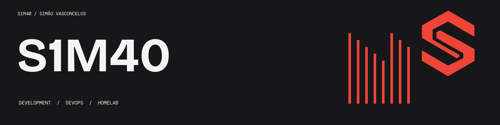

  <!-- Place S1M40-readme-banner.png in your repository root or an /assets folder -->
  

<h1 align="center">Hi there, I'm Simão (S1M40) 👋</h1>

  <b>Developer & Aspiring DevOps Engineer</b> 
  Building systems, tinkering with homelabs, and automating modern infrastructure.

  
  

---

### ⚡ Quick Overview

- 🎂 **Age:** 24
- 🚀 **Direction:** DevOps, Linux administration, and infrastructure automation
- 🌱 **Currently leveling up in:** Python for tooling, containerization (Docker), and CI/CD pipelines
- 👯 **Open to collaborate on:** Open-source developer tools, automation scripts, and creative community projects
- 🎮 **Passions:** Homelab self-hosting, gaming, and systems architecture

---

### 🎯 2026 Focus

- [ ] Master Python for automation scripts and tooling
- [ ] Expand homelab container orchestration and pipeline reliability
- [ ] Make active, regular contributions to open-source projects

---

### 📬 Connect With Me

  
  &nbsp;&nbsp;
  

